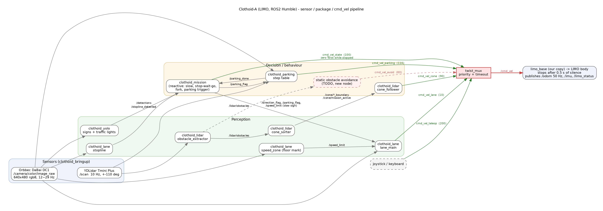

# 시스템 통합 / mux 할 일

담당: 주영. 2026-11-03 기준. 파이프라인 그림은 `docs/pipeline.png`(원본 `docs/pipeline.dot`, 다시 그리기: `dot -Tpng -Gdpi=130 docs/pipeline.dot -o docs/pipeline.png`).

토픽 계약은 `INTERFACES.md`, 패키지별 현황은 `PACKAGES.md`, 차에서 확인할 것은 `FIELD_TEST.md`.

## 결정한 것

- **미션 로직은 반응형으로 둔다.** 순서 상태기계를 만들지 않는다. 미션에서 막혀 처음부터 다시 시도하는 등의 엣지케이스가 순서 기반 상태와 잘 맞지 않는다. 대신 아래 "반응형의 대가"를 처리한다.
- 정적 장애물 회피 노드는 주영이 담당한다(`clothoid_lidar`, 출력은 `/cmd_vel_avoid`).
- E-stop은 조이스틱(`/cmd_vel_teleop`, 우선순위 200)으로 처리한다. 확인할 것은 아래 4번.

## 할 일

### 1. 통합 launch (진행 중, 브랜치 `feature/integration-launch`)
- [x] `clothoid_bringup/launch/full.launch.py`: bringup + lane, yolo, lidar(콘), parking, mission. `use_lane`, `use_yolo`, `use_lidar_missions`, `use_parking`, `use_mission`으로 각각 끌 수 있고 `debug`, `backend`, `model_path`는 launch 인자로 내려보낸다. Docker에서 인자 해석까지 확인(전체 실행은 하드웨어 패키지가 없어 Jetson에서만 가능).
- [ ] Jetson에서 `ros2 launch clothoid_bringup full.launch.py` 한 번 실행해 노드 전부 뜨는지 확인.
- [x] `limo_base`에 `steering_scale`, `max_inner_angle`, `cmd_timeout` 인자를 넘기도록 bringup·full 연결(기본값은 공식값, 확정은 바닥 시험 뒤). 2026-11-04 PC(Humble)에서 빌드와 `--show-args`만 확인, Jetson 실행 전.
- [x] 안전 장치(2026-11-04, 브랜치 `feature/mux-mission`): `require_arm`(기본 `false`로 변경 2026-11-09, 아래 "첫 자율 실행 절차"), `mux_output`(`/cmd_vel_dry`면 섀도 주행).
- [x] `latency_monitor`(2026-11-05, `clothoid_bringup`): 토픽별 Hz·최대 끊김·header 기준 나이, `cmd_vel_*`는 원본 센서 stamp부터의 지연, mux 승자 집계. `full.launch.py use_latency_monitor:=true latency_csv:=~/bags/lat.csv`. bag 재생(PC)에서 `/scan` 도착 시 나이 약 97 ms(스탬프가 회전 시작), 카메라→`/cmd_vel_lane` 17~35 ms. Jetson에서 다시 잰다.
- [x] 오프라인 분석 도구 `tools/offline_pipeline/`: 차량별 warp(`--camera`), track2026, `lane_width_m`에 맞춘 최소 수정(2026-11-10, 브랜치 `feature/offline-tools`). 1105 bag은 `--camera limo1`.
- [ ] main의 미션이 자리 잡은 뒤 도구 본격 개편: 단계 목록 하나로 정리, 이름 붙은 열, 새 검출기(`/stopline_near`, finish 등) 추가.
- [x] `scripts/setup_jetson.sh`(`--check`, `--no-build` 지원), `requirements-jetson.txt`(dl_env용, ultralytics만). Docker에서 `--check` 동작만 확인했고 Jetson 실행은 아직.
- [ ] limo1에서 `bash scripts/setup_jetson.sh --check` 후 설치, limo2에서도 같은 결과인지 확인.

### 2. 정적 장애물 회피 노드
- [ ] 입력 `/lidar/obstacles`, 출력 `/cmd_vel_avoid`. 정차 LIMO(폭 약 0.3m)는 콘용 `max_width 0.15`에서 제외되므로 별도 파라미터 세트.
- [ ] `cone_follower`와 같은 우선순위(80)를 쓰므로 동시에 발행하지 않게 게이트. 안으로는 "코스가 켜진 동안만 발행"(콘은 `/cone/mission_active`로 이미 그렇게 한다)을 따른다.
- [ ] 차선 변경에 애커만 기준 전방 약 0.85m가 필요하다는 제약 반영.

### 3. 정지 위치(±5cm) — 구현 (2026-11-09, `namgyu/mis`)
- `clothoid_mission`이 직접 한다. YOLO가 보행자 표지판/적색 신호를 보면 무장하고, 무장 동안만 카메라를 구독해 `clothoid_finish`의 `FinishCore`를 돌린다(`line_stop.py`의 `LineStopCore`).
- finish 그대로: `Bev` 거리, `Tracker` 오돔 x0.98, 3프레임 확정, 목표 = 선 - 범퍼 0.161 - `stop_gap` 0.03, 속도 `min(0.2, 1.5 x 남은 거리)`(최소 0.06).
- finish와 다른 점 3가지:
  1. 가로선(정지선)은 흰색으로 찾는다(왼쪽 선은 노란색 그대로).
  2. 가로선 행 판정 = 끊기지 않은 흰 구간이 밴드의 70% 이상(주차 시작선 `NearLineParams.min_run` 규칙). finish의 "50% 채움"은 신호등 앞 "천천히" 글자를 정지선으로 잡아 26 cm 일찍 섰다.
  3. 확정 뒤 4 cm 넘게 먼 선은 무시. 횡단보도 줄무늬/끝선을 잡아 56 cm 늦게 서던 것을 막는다.
- 조향은 계속 `lane_main`. FinishCore의 속도만 `/speed_limit`, STOP이면 `/cmd_vel_state` 0. finish의 왼쪽 노란선 조향은 보행자 횡단보도 앞 지그재그에서 9° 틀어져서 쓰지 않는다(`lost_hold_sec` 1e9로 왼쪽 선 놓침 중단도 끔).
- 2025 줄무늬 검출(`/stopline_detected`)은 주석 처리. 2026 미션에 횡단보도 인지는 필요 없다(규정은 정지선 기준).
- 시뮬(YOLO, limo2 카메라): 보행자 범퍼 -0.5 cm(옆 0.8 cm), 신호등 +0.1 cm(옆 1.1 cm).
- [ ] 바닥에서 확인. RViz: `ros2 launch clothoid_debug stop_sim.launch.py model_path:=...`(시뮬), `rviz/stop.rviz`.

### 4. E-stop / teleop
- 우리 저장소에는 `/cmd_vel_teleop`을 발행하는 노드가 없다. `bringup`은 `twist_mux` 입력만 만들어 둔다. 조이스틱이 이미 있다고 했으니 **어떤 노드가 어떤 토픽에 내는지 확인**한다(`ros2 node list`, `ros2 topic info`).
- 조이스틱을 `/cmd_vel_teleop`(200)으로 보내면 조종은 되지만, **버튼을 놓으면 mux가 자율주행으로 돌아간다.** 멈춤 상태를 유지하려면 `twist_mux`의 lock(Bool 토픽)을 쓰는 별도 비상 정지 버튼이 필요하다. 어느 쪽을 쓸지 정한다.
- **시험용 arm lock (적용, 2026-11-04):** `config/twist_mux_arm.yaml`, lock `estop`(`/estop`, 우선순위 150, timeout 0.3s). `require_arm:=true`(기본)일 때만 로드된다.
  - `twist_mux` humble 소스 기준 lock은 `data == true`이거나 **timeout 동안 메시지가 없으면** 잠긴다. 시작 때는 아무것도 받지 않았으므로 잠긴 채로 뜬다. 잠기면 우선순위 150 **미만** 입력(state, parking, avoid, lane)이 막히고 teleop(200)은 통과한다.
  - 사용: `ros2 topic pub -r 10 /estop std_msgs/msg/Bool "{data: false}"`가 도는 동안만 자율주행. Ctrl+C면 정지(lock 0.3s + `limo_base` `cmd_timeout` 0.5s, 최대 약 0.8s, 0.3m/s에서 약 24cm). `data: true`를 보내면 래치 정지.
  - PC 확인(2026-11-04, 가짜 입력, `twist_mux` 단독): lock 있음 → 시작 직후 0건, `false` 수신 중 통과, 끊고 0.3s 뒤 차단, `true`면 차단, teleop은 잠금 중에도 통과. lock 없음 → lane이 항상 통과. Jetson·실차는 미확인.
  - **대회에서는 `require_arm:=false`**(노트북 통신이 끊기면 차가 서서 15초 제한에 걸린다). 대회용 비상 정지는 같은 lock에 조이스틱 버튼으로 `true`를 보내는 래치 방식을 검토한다.
  - 주의: 스크립트에서 `ros2 run`을 `kill`하면 실제 노드 프로세스가 남는다(PC에서 확인). 시험 뒤 `pgrep -af twist_mux`로 확인한다.

### 4-2. 첫 자율 실행 절차 (제안)
1. **섀도 주행**: `full.launch.py mux_output:=/cmd_vel_dry`. `/cmd_vel`이 아무 데도 나가지 않아 차가 움직이지 않는다. RC로 트랙을 돌며 `/cmd_vel_*`, `/cmd_vel_dry`, 센서를 bag으로 기록하고 "자율이었으면 무엇을 냈을지"를 본다.
2. **바퀴를 띄운 상태**: `mux_output` 기본값으로, arm(`/estop false`)을 걸었다 끊으며 정지 지연을 잰다.
3. **바닥**: `use_*`로 미션을 하나씩만 켜고 `ros2 param set /lane_main base_speed 0.2`로 낮춘 속도에서, arm 명령은 사람이 쥐고 있는다.

### 5. 15초 제한과 2회 시도
15초를 넘기면 해당 미션은 어차피 0점이므로 소프트웨어가 15초를 지켜 주는 것이 아니라, **영영 갇히지 않게 하는 와치독**이 목적이다.
- [ ] 신호등: 녹색을 놓쳐도 영영 서 있지 않게 한다. 예: 정지 중 신호등 검출이 일정 시간 없으면 출발, 정지 후 상한 시간(`stop_max_sec`)을 두고 강제 출발. 상한값은 규정 기준(녹색 후 15초)보다 짧게.
- [ ] 보행자: 대기 3.5초 고정이라 이미 상한이 있다.
- [ ] 주차: `sensor_step_max_sec`가 이미 있다. 스텝 표 전체 상한도 같은 방식으로.
- [ ] 로그: 각 상태에 들어간 시각과 머문 시간을 남겨 현장에서 15초에 근접했는지 본다.

### 6. 반응형의 대가: 상태 초기화
순서 상태가 없으므로 아래 잠금 값이 2회차 시도에 남는다.
- [ ] `/parking_flag`(잠김), `/direction_flag`(마지막 값), `cooldown_sec`(같은 정지를 15초 무시), 진행 중이던 stop 상태.
- [ ] `/mission/reset`(Bool 또는 서비스)을 만들어 2회차 시작 전에 부른다. 노드를 껐다 켜는 것으로 대신할 수 있지만 현장에서 느리다.
- [ ] `cooldown_sec 15`는 막혀서 같은 표지판 앞으로 돌아오는 재시도를 무시한다. 재시도가 필요한 미션이면 짧게 하거나 위치(주행거리) 기준으로 바꾼다.

### 7. mux 점검 (`twist_mux.yaml`)
| 항목 | 내용 | 확인 |
|---|---|---|
| lane 타임아웃 0.3s | 어두울 때 프레임 간격 최대 0.16s | 트랙 조명에서 fps 측정 후 |
| mission 해제 | 발행을 멈추면 0.3s 뒤 lane 복귀 | 정지 거리 계산(3번)에 포함 |
| 콘 구간 lane | 차선 판정이 없는 구간인데 `lane_main`이 계속 계산 | `cone_follower`가 비는 프레임에 lane 값이 새는지 |
| 서행 | `/speed_limit`은 `lane_main`에만 적용 | avoid, parking 속도는 별도 |
| 주차 중 mission | state(100)가 parking(90)보다 높음 | 주차 중 신호등 오탐이 주차를 덮는지. `/parking_flag` 동안 mission 정지를 끌지 |
| 정지 명령 | `Twist(0,0)` | 바닥에서 조향이 중앙에 오는지 |

### 7-2. 우선순위 재설계 (2026-11-09: parking 110 적용. 2026-11-13: cone 90 `/cmd_vel_cone` 분리 적용. finish는 `namgyu/parking` 병합 때 105로 맞춘다)
지금 값은 2025 미션 기준이다. 원칙: **각 노드는 자기 미션 구간에서만 발행하고, 우선순위는 구간이 겹치거나 오탐일 때 누가 이기는지만 정한다.**

| 입력 | 지금 | 제안 | 이유 |
|---|---|---|---|
| teleop | 200 | 200 | 사람 최우선 |
| lock `estop` | 없음 | 150 | 시험용 arm lock (4번, 적용) |
| parking | 90 | **110** | 마지막 미션이고 바로 앞이 신호등이다. 주차 중 신호등 잔상이나 시작선을 정지선으로 오인한 state 정지가 주차를 덮지 않게 한다. parking은 `/parking_flag`와 시작선이 둘 다 있어야 발행해 구간이 좁다. 대안: state 100을 유지하고 mission이 `/parking_flag` 동안 정지를 끈다 |
| state | 100 | 100 | 보행자·신호등 정지는 주행보다 위 |
| **cone** | 90 (`/cmd_vel_cone`, 2026-11-13 적용) | **90, `/cmd_vel_cone` 신설** | 원리가 다르다(콘 벽 사이 탈출 vs 3차선 차량 회피 경로계획). 콘 벽을 회피 노드가 장애물로 볼 수 있으므로 cone이 이긴다. 입력이 나뉘면 bag에서 누가 냈는지도 바로 보인다 |
| avoid | 80 | 80 | 정적 장애물(정차 LIMO) 회피. `/cone/mission_active` 동안은 발행하지 않는다 |
| lane | 10 | 10 | 기본 주행 |

정할 것: parking과 state의 순서(교환 또는 mission에서 게이트). 정해지면 `twist_mux.yaml`, `INTERFACES.md` 표, 각 노드 `cmd_topic`을 함께 바꾼다.

### 7-3. 라이다 담당에게 요청할 것 (cone_follower, 제안)
1. [x] `cmd_topic`을 `/cmd_vel_cone`으로 바꾼다(2026-11-13, `feature/mux-cone`에서 `cone_follower_node.py` 기본값을 바꿨다).
   계기: 1113 auto 02/05에서 static_avoid가 콘 구간에서 다시 시작해 cone_follower와 같은 `/cmd_vel_avoid`에 명령이 섞였다.
2. **콘 구간 동안 제어권 유지:** 지금 `control()`은 경계 메시지가 올 때만 돌고, 경계가 모두 stale이거나 `decide()`가 `None`이면 아무것도 내지 않는다. `cone_sorter`는 빈 경계를 발행하지 않는다. 0.3s 조용하면 mux가 `lane`으로 넘어가고, 차선 판정이 없는 구간에서 `lane_main`이 콘이나 바닥 무늬를 차선으로 보면 그쪽으로 조향한다.
   - 제안: `/cone/mission_active` 동안 **타이머(예: 20Hz)로 항상 발행**한다. 판단 성공이면 그 명령, 실패면 `hold_sec`(예: 0.3s) 동안 직전 명령, 그 뒤에는 `Twist(0,0)` 정지. `mission_active`가 false가 되면 발행을 멈춰 lane이 이어받는다.
   - 덤: 좌·우 경계 메시지마다 따로 `control()`이 돌아 한쪽이 stale로 판정되던 흔들림(위험 D3)도 줄어든다.
   - lane_main이 `/cone/mission_active`를 보고 꺼지는 방법은 패키지 간 결합이 생겨 쓰지 않는다.

### 8. 환경과 배포
- [ ] limo1: `twist_mux`, `diagnostic_updater` 4.0.7, 저장소, 수정 `limo_base`.
- [ ] 호차 번호와 limo1/limo2 대응 기록(대회 차량 7, 8호차).
- [ ] `ROS_DOMAIN_ID`를 차마다 다르게.
- [ ] 출발 전 `git bundle` 백업, Jetson에서 pull + 빌드 완료.

### 9. 미션 이음새 점검 (2026-11-05, 코드 기준)
mux는 출력 타이머가 없다. 입력 메시지가 올 때만 내보내고, 0을 스스로 보내지 않는다. 그래서 제어하던 입력이 조용해지면, 아래 입력의 다음 메시지가 오거나 `limo_base` `cmd_timeout`(0.5 s) 워치독이 0을 보낼 때까지 **마지막 명령이 계속 실행된다.**

| # | 위험 | 근거 | 제안 | 담당 |
|---|---|---|---|---|
| R1 | 넘겨주는 순간 마지막 명령이 0.5 s 남는다(주차 마지막 스텝, 콘 후진 −0.2 m/s) | `parking_node.py` 완료 뒤 침묵, `cone_follower` 종료 시 침묵 | 발행을 멈출 때 `Twist(0)` 1회 | parking, 라이다 |
| R2 | 신호등 정지에 상한 시간이 없다. 녹색을 놓치거나 YOLO가 죽으면 영원히 정지한다 | `mission_logic.py:97-100` | `stop_max_sec`(5번 와치독) | 주영 |
| R3 | 신호등 대기(8 s) 중 다른 정지선(횡단보도)이 보이면 신호등 정지를 한다 | `arm_timeout_sec` 8, 정지선 종류 구분 없음 | 대기 시간 단축, 또는 횡단보도 정지선과 구분 | 주영 |
| R4 | 신호등이 풀리면 대기 중이던 보행자 정지 3.5 s가 이어서 걸릴 수 있다 | 풀릴 때 `light_armed_at`만 지움 | 정지가 풀릴 때 다른 대기도 지움 | 주영 |
| R5 | `/parking_done`을 아무도 읽지 않는다. `/parking_flag`가 끝까지 참이라 lane이 주차 모드(폭 231, 갈림길 무시)로 남는다 | `Inputs.parking_done`이 `step()`에서 쓰이지 않음 | 완료 뒤 flag 해제, lane 폭 복원 | 주영, 차선 |
| R6 | 주차가 다시 시작될 수 있다. 파라미터를 바꾸거나 노드를 재시작하면 시퀀스가 새로 생기고, flag는 1 s마다 다시 온다. 시작선 HSV가 차선 노랑 범위를 포함한다 | `parking_node.py:107-108,143`, `parking.yaml:41-42` | 완료 상태를 flag 해제(R5)로 막는다 | parking |
| R7 | 콘 모드가 아무 데서나 켜지고 mission이 막지 않는다. 한쪽 경계만 보이면 후진한다 | 1105 bag, `cone_follower.py:202-209` | 7-3 요청에 추가, LIDAR 세션에 전달(2026-11-05) | 라이다 |
| R8 | `/speed_limit`은 lane에만 적용된다(콘·주차는 무시) | `lane_main.py` 구독만 있음 | 콘 구간 서행이 필요한지 규정 확인 | – |
| R9 | 재시작하면 상태가 다 사라진다. transient_local도 respawn도 없다. 2회차는 노드 전부 재시작이 필요하다 | 6번 | `/mission/reset` | 주영 |

- 먼저 할 것: R2, R5, R1. R2와 R5는 mission 노드 안에서 끝나므로 설계 승인 뒤 바로 할 수 있다.
- 기본값 주의: `full.launch.py` `backend:=none`이면 `/detections`가 늘 비어 있어 신호등·보행자·갈림길·주차가 하나도 켜지지 않는다.

### 10. 런치를 껐다 켜면 mux가 멈추는 문제 (작년 대회장)
- 작년 시스템은 ROS1 Noetic(`roscore` + `ackermann_cmd_mux`, `MIGRATION_PLAN.md`)이었다. 원인 기록은 없다.
- 작년 쪽 가설: 대회장 네트워크에 붙으면 NTP가 시계를 크게 옮긴다. ROS1 타이머는 시계가 뒤로 가면 멈출 수 있다. 연습장(인터넷 없음)에서 재현되지 않았고 재부팅으로만 풀렸다는 점과 맞는다.
- 올해(ROS 2, Fast DDS 기본)도 "차가 안 움직이고 재부팅하면 풀리는" 같은 증상을 낼 수 있는 원인이 있다.

| # | 원인 후보 | 확인 | 정리 |
|---|---|---|---|
| 1 | Ctrl+C 뒤에도 프로세스가 남는다(PC에서 `ros2 run` kill로 확인). `limo_base`는 시리얼 read 스레드를 join하지 않고 블로킹 read에 머문다(`limo_driver.cpp:138,153`). 새 `limo_base`는 포트를 못 열면 `exit(-1)`한다(`limo_driver.cpp:131-151`). twist_mux가 둘이면 출력이 겹친다 | `ps -ef \| grep -E 'twist_mux\|limo_base'`, `lsof /dev/ttylimo`, `ros2 node list`에서 중복 확인 | PID로 kill, 안 되면 `kill -9` |
| 2 | Fast DDS 공유메모리 잔여물. 비정상 종료 뒤 `/dev/shm/fastrtps_*`가 남으면 같은 기기 안 노드끼리 통신이 끊길 수 있고 재부팅하면 풀린다 | `ls /dev/shm` | 모든 노드를 끈 뒤 `fastdds shm clean` |
| 3 | 대회장에서만: `ROS_DOMAIN_ID` 충돌. `CLOTHOID_REMOTE=1`로 노트북을 붙이면 같은 도메인의 다른 팀 `/cmd_vel`·`/estop`이 섞인다 | `ros2 topic info -v /cmd_vel`(낯선 노드) | 차마다 다른 도메인(8번) |
| 4 | 대회장에서만: NTP 시계 점프. twist_mux 타임아웃은 노드 시계(`now()`)로 잰다 | `timedatectl`, 대회장 Wi-Fi 연결 전후 비교 | 주행 중 NTP 끄기 검토 |
| 5 | arm lock: `require_arm:=true`에서 `/estop false` 발행 없이 다시 실행하면 정상적으로 침묵한다 | `ros2 topic hz /estop` | 대회는 `require_arm:=false` |

- 제안(설계 승인 뒤): `scripts/preflight.sh`. 1~4를 확인하고 `--clean`이면 남은 프로세스와 공유메모리를 정리한다. 런치를 다시 켜기 전에 매번 돌린다.
- launch의 노드에 `sigterm_timeout`을 짧게 준다.
- FIELD_TEST에 "런치 10회 껐다 켜기 + 매번 `/cmd_vel` 확인" 시험을 넣는다. 연습장에서도 대회장처럼 Wi-Fi에 붙여서 해 본다.

### 10-2. merge하면서 할 일 (주영, 2026-11-09)
- [ ] `namgyu/parking`을 합칠 때 `twist_mux.yaml`의 `finish` 우선순위를 90이 아니라 **105**로 한다(parking 110 > finish 105 > state 100). 90이면 state보다 낮다. `decision_viz.py`의 `MUX_INPUTS`에도 finish를 넣는다.
- [ ] `clothoid_mission`의 R2~R4, R9(9번 표)를 처리한다.

### 11. 정적 장애물 회피 개발이 끝나면 할 일 (2026-11-09 기록, 지금은 보류)
1. `feature/static-avoid`를 정리해 main에 넣는다.
2. `full.launch.py`에 `avoid.launch.py`, `use_avoid` 스위치, `camera` 인자 전달을 넣고 새 토픽을 `INTERFACES.md`에 적는다.
3. 콘 시작 조건과 회피를 함께 돌려 본다. 1108 bag 11개에서는 콘 모드가 한 번도 켜지지 않았다(시작 상자 안 군집 최대 5개, 기준 6개). 실제 콘이 섞이면 다시 본다.
4. `base_speed` 0.8에서 회피 진입을 확인한다. 약 1.5 m 앞에서 켜지고, 켜지기 전 약 36 cm를 간다. 1108 bag은 수동 주행이다.
5. 횡단보도 정지 → 회피 → 섬 인계 → A/B → 콘 이음새를 `latency_monitor`로 본다(모니터 목록에 finish 추가).
6. 섀도 주행 → 바퀴 띄우기 → 미션별 저속 → 한 바퀴 → 재시도·재시작 시험 순서로 실차 확인.
7. 대회장 점검: `ROS_DOMAIN_ID`, WB 고정, 차선 폭(규정 0.55 m, 현재 0.50 m), 차량별 `camera:=`.

## 지금은 못 하는 것 (플랫폼 실험 필요)
바닥 원 주행으로 `steering_scale` 확정, RC 우선순위와 `control_mode`, 라이다 0° 방향과 TF 실측, 트랙 조명 fps와 노출 고정, 세 `warp_*` 재튜닝, `motion_mode` 순간 변화 확인. 순서는 `FIELD_TEST.md`.
