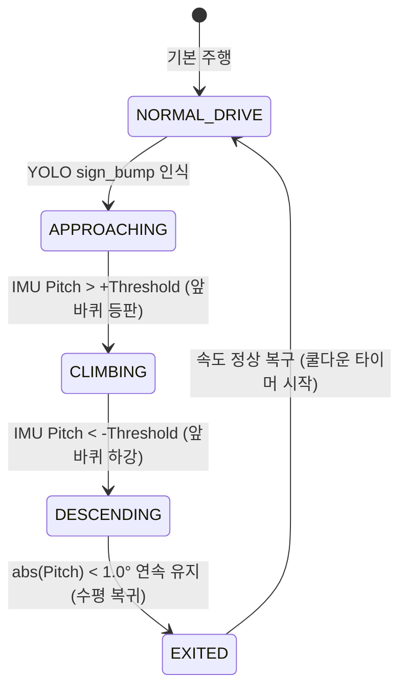

# 과속방지턱(Speed Bump) 구간 주행 & IMU 제어 가이드

> **작성일**: 2026-11-09  
> **대상**: 방지턱 미션 제어 및 센서 퓨전 개발  
> **관련 패키지**: `clothoid_mission`, `clothoid_lane`, `limo_base`

---

## 1. 개요 및 대회 규정

- **규정 요구사항**: 과속방지턱 표지판(`sign_bump`) 인식 후 방지턱 구간을 **0.2 m/s 이하**의 속도로 서행 통과해야 함.
- **기존 방식의 한계 (타이머 기반)**:
  - 표지판을 인식한 순간부터 단순 4초 타이머로 감속할 경우, 차간 거리나 인식 거리에 따라 **턱에 오르기도 전에 가속**하거나 **턱 위에서 속도를 올려 실격/감점**될 위험이 큼.
  - 방지턱을 넘는 동안 카메라가 위아래로 흔들려 **차선 인식 및 조향이 급격히 튀는 현상** 발생.
- **해결책**: **YOLO(사전 감속 트리거)** + **IMU Pitch 센싱(실시간 턱 등판/탈출 감지 및 조향 보정)** 융합.

---

## 2. IMU 데이터 해석 & 핵심 원리

LIMO 본체 드라이버는 `/imu` 토픽을 **100 Hz**로 발행합니다.

### 2.1 쿼터니언 → Pitch 각도 변환
차량의 앞뒤 기울기를 나타내는 각도는 **Pitch(피치)**입니다.

```python
import math
from geometry_msgs.msg import Quaternion

def get_pitch_deg(q: Quaternion) -> float:
    # 쿼터니언 (x, y, z, w) -> Pitch 각도 (도, degree)
    sinp = 2.0 * (q.w * q.y - q.z * q.x)
    if abs(sinp) >= 1.0:
        pitch_rad = math.copysign(math.pi / 2, sinp)
    else:
        pitch_rad = math.asin(sinp)
    return math.degrees(pitch_rad)
```

### 2.2 방지턱 통과 시 Pitch 프로파일

```
       [2. 앞바퀴 하강 / 뒷바퀴 등판]
              Pitch (-) 음수
                 \      /
  Pitch (+)       \    /        Pitch ≈ 0°
 [1. 앞바퀴 등판]   \  /       [3. 완전 탈출 후 수평]
     /\             \/             ──────────────
────/  \─────────────────────────
 (평지)
```

1. **앞바퀴 등판 (Nose Up)**: 차체 앞부분이 들리며 `Pitch > +Threshold` (예: +3° ~ +6° 이상 급상승)
2. **앞바퀴 하강 & 뒷바퀴 등판 (Nose Down)**: 차체 앞이 숙여지며 `Pitch < -Threshold` (음수로 급전환)
3. **뒷바퀴 탈출 (Leveling)**: 뒷바퀴까지 완전히 내려오며 `abs(Pitch) < 1.0°` (수평 복귀 및 안정화)

---

## 3. 방지턱 상태 머신 (FSM) 구조



- **`APPROACHING` (접근 서행)**: 속도를 규정 속도인 **0.2 m/s**로 사전 감속.
- **`CLIMBING` / `DESCENDING` (방지턱 통과 중)**:
  - 0.2 m/s 속도 유지.
  - **카메라 화각 흔들림 방지**: 조향각(Steering)을 고정하거나 저주파 필터(LPF)로 급회전 방지.
- **`EXITED` (탈출)**: 차체가 수평으로 복귀하고 0.3~0.5초간 안정화되면 정상 주행 속도로 가속.

---

## 4. 실전 주행 꿀팁 (Crucial Tips)

### Tip 1. 방지턱 통과 중 차선 조향(Steering) 흔들림 방어
- **문제**: 방지턱을 올라탈 때 카메라가 위를 보면서 차선 하단부가 시야에서 사라지거나, 노면의 그림자/턱 모서리를 차선으로 오인식하여 바퀴를 꺾어버릴 수 있음.
- **해결책**:
  - `CLIMBING` 상태에 진입하면 차선 인식 노드의 조향 출력 변화율(Slew Rate)을 강하게 제한하거나,
  - 방지턱을 넘는 동안 **진입 직전의 조향각을 그대로 유지(Steering Lock)**하도록 설정.

### Tip 2. 저속(0.2 m/s) 등판 시 턱 걸림(Stall) 방지
- **문제**: LIMO의 0.2 m/s는 모터에 인가되는 전압이 낮아, 방지턱 턱부분에 앞바퀴가 닿았을 때 차가 멈칫하며 못 올라갈 수 있음.
- **해결책**:
  - 오도메트리 속도(`/odom`)가 0.05 m/s 이하로 떨어지는데 IMU Pitch가 올라가기 시작했다면, 순간적으로 명령 속도를 살짝(0.25~0.3 m/s) 올려 턱을 넘길 수 있는 토크를 확보한 뒤 즉시 0.2 m/s로 복귀.

### Tip 3. 센서 노이즈 필터링 (False Positive 방지)
- 주행 중 바닥의 작은 요철이나 가속/감속 시 차체 출렁임(Pitch)으로 인해 오작동할 수 있음.
- **필터링 규칙**:
  1. **YOLO 선행 조건**: 반드시 `sign_bump` 표지판이 최근에 감지된 상태에서만 IMU 피크 검사를 활성화 (Gate 조건).
  2. **이동 평균(Moving Average)**: 최근 5~10개(50~100ms) IMU 샘플의 이동 평균을 취해 고주파 진동 노이즈 제거.

---

## 5. 빠른 구현을 위한 코드 스니펫

```python
class SpeedBumpDetector:
    def __init__(self, pitch_threshold_deg: float = 4.0):
        self.pitch_thresh = pitch_threshold_deg
        self.is_armed = False       # YOLO 표지판 감지 시 True
        self.on_bump = False        # 현재 턱 위인지 여부
        self.level_count = 0        # 수평 안정 카운트

    def update_imu(self, pitch_deg: float, dt: float) -> bool:
        """현재 방지턱 통과 중인지 여부를 반환 (True: 감속 및 조향 보호 필요)"""
        if not self.is_armed:
            return False

        # 앞바퀴가 들리면 턱 진입
        if not self.on_bump and pitch_deg > self.pitch_thresh:
            self.on_bump = True
            self.level_count = 0

        # 턱 위에서 수평으로 복귀하는지 체크
        if self.on_bump:
            if abs(pitch_deg) < 1.5:
                self.level_count += 1
                # 100Hz 기준 30개 샘플(0.3초) 이상 수평 유지 시 탈출
                if self.level_count > 30:
                    self.on_bump = False
                    self.is_armed = False  # 쿨다운 시작
            else:
                self.level_count = 0

        return self.on_bump
```
